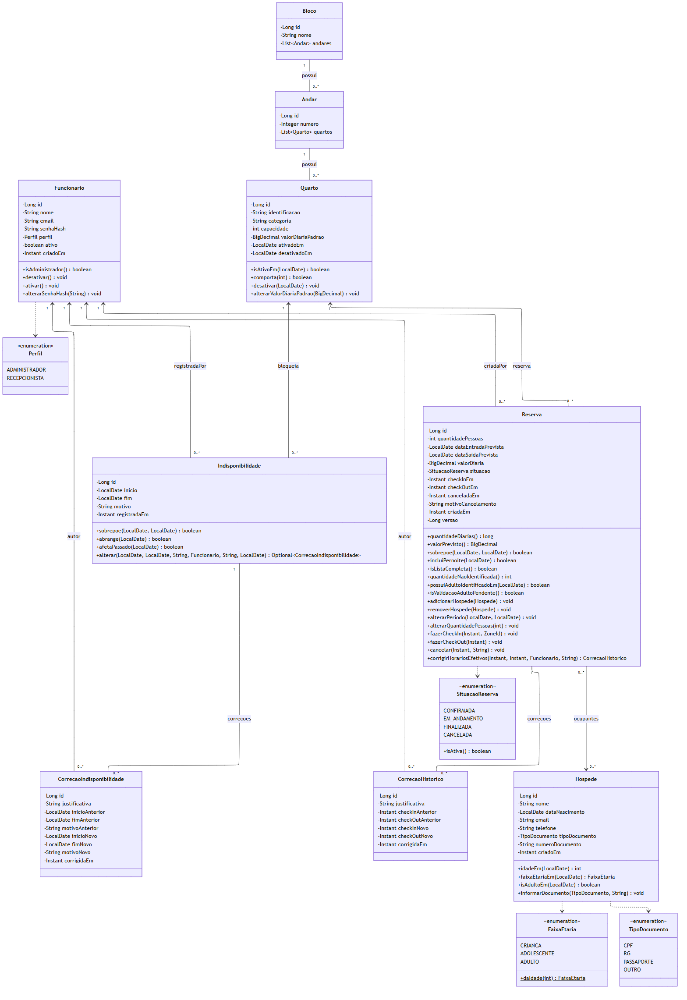

# Documentação técnica — Etapa 1

**Revisão:** 25/10/2026. **Situação:** em elaboração; UML, entidades e repositórios da Etapa 1 implementados e testados.

Identificação da equipe e URL da aplicação: preencher no [README](../README.md), com no máximo cinco integrantes e um líder.

## 1. Visão Geral do Projeto

### 1.1 Nome do Produto

Sistema de Gestão de Hospedagens — nome técnico provisório. Nome comercial a definir.

### 1.2 Declaração do Problema e Justificativa

Pequenos hotéis e pousadas precisam acompanhar reservas, disponibilidade e presença de hóspedes. Controles dispersos em cadernos e planilhas dificultam consultas e favorecem conflitos de reserva. O sistema pretende centralizar as informações e apresentar a ocupação por quarto e data, preservando o histórico de estadias.

O [termo de abertura](termo-de-abertura.md) detalha justificativa, riscos e entregáveis. O [escopo](escopo.md) delimita o produto e os critérios de aceite.

### 1.3 Público-Alvo e Objetivos do Sistema

Uso interno por administradores e recepcionistas de um único estabelecimento. Apoiar cadastros, reservas, check-in, check-out e consulta da ocupação passada, atual e prevista. Hóspedes não acessam o sistema nesta versão.

## 2. Especificação de Requisitos

### 2.1 Requisitos Funcionais (RF01, RF02, ...)

A lista detalhada RF01–RF20 está na seção 3 de [Concepção e Requisitos](requisitos.md). Inclui autenticação, funcionários, estrutura física, hóspedes, reservas, entradas/saídas, mapa temporal e correção de histórico. A seção 4 registra as regras de negócio e a seção 6 os cenários de aceite.

### 2.2 Requisitos Não Funcionais (RNF01, RNF02, ...)

RNF01–RNF11 estão na seção 5 de [Concepção e Requisitos](requisitos.md): segurança, banco relacional, transações, API REST em JSON, recuperação e validação, entre outros.

**Pendente:** requisito mensurável de desempenho, com tempo de resposta, volume de dados, carga concorrente e ambiente de medição acordados. Não há valores quantitativos aprovados.

H2 em memória é a configuração inicial de desenvolvimento. Migrações, persistência durável e backup permanecem requisitos para a evolução do produto e ainda não estão implementados.

## 3. Arquitetura e Modelagem de Dados

Backend Java 21 com Spring Boot 4.1.2, Web MVC, Security e Spring Data JPA. Frontend separado consumindo a API REST. H2 em memória no perfil `dev`.

Organização prevista: controller → service → repository → banco, com DTOs nos contratos REST. Hoje existem inicialização, healthcheck, configuração de segurança, o modelo de domínio em `model` e os repositórios em `repository`. Serviços e endpoints de negócio ainda serão desenvolvidos.

### 3.1 Diagrama de Classes UML



O diagrama corresponde às classes em `src/main/java/br/com/hotelaria/hotelaria/model`. Getters, setters e construtores foram omitidos.

| Arquivo | Uso |
|---|---|
| [diagrama-classes.mmd](diagrama-classes.mmd) | Código-fonte editável em [Mermaid](https://mermaid.js.org/syntax/classDiagram.html). Altere sempre este arquivo |
| [diagrama-classes.pdf](diagrama-classes.pdf) | Versão para entrega e impressão |
| [diagrama-classes.png](diagrama-classes.png) | Imagem exibida nesta seção e para colar em documentos |

Para editar visualmente, cole o conteúdo do `.mmd` no [Mermaid Live Editor](https://mermaid.live). Depois de alterar, regenere o PDF e o PNG na raiz do projeto com o [mermaid-cli](https://github.com/mermaid-js/mermaid-cli):

```bash
npx -p @mermaid-js/mermaid-cli@11.4.2 mmdc -i docs/diagrama-classes.mmd -o docs/diagrama-classes.pdf -b white --pdfFit
npx -p @mermaid-js/mermaid-cli@11.4.2 mmdc -i docs/diagrama-classes.mmd -o docs/diagrama-classes.png -b white -s 2
```

Leitura das cardinalidades: todo andar pertence a exatamente um bloco, e todo quarto a exatamente um andar. Toda reserva aponta para um quarto e para o funcionário que a criou. A lista de hóspedes pode estar vazia ou incompleta até o check-in (RN14). Correções e indisponibilidades sempre têm autor. Setas indicam associações unidirecionais; linhas sem seta são bidirecionais.

#### Decisões de modelagem

| Decisão | Motivo |
|---|---|
| **Reserva e hospedagem são a mesma entidade.** A situação evolui de `CONFIRMADA` para `EM_ANDAMENTO` (check-in) e `FINALIZADA` (check-out), ou de `CONFIRMADA` para `CANCELADA`. | A RN11 já define essas situações para a reserva. Uma estadia sempre tem exatamente uma reserva, com ocupantes e quarto iguais aos dela; uma entidade separada só duplicaria dados. O período previsto (`dataEntradaPrevista`, `dataSaidaPrevista`) e os horários efetivos (`checkInEm`, `checkOutEm`) ficam em campos distintos, preservando ambos. |
| Ocupantes como `@ManyToMany` `Set<Hospede>`, sem entidade intermediária. | A RN08 dispensa papéis entre ocupantes; não há atributo na associação. O `Set` e a chave primária composta da tabela `reserva_hospede` impedem a mesma pessoa duas vezes (RF09). |
| Datas previstas em `LocalDate`; instantes efetivos em `Instant`. | Diárias seguem o intervalo `[entrada, saída)` por data (RN02). Instantes são gravados como `timestamp with time zone` e convertidos para a zona do hotel (RN01), recebida como `ZoneId` em `fazerCheckIn`. A zona padrão do hotel ainda precisa ser configurada. |
| Dinheiro em `BigDecimal` com `numeric(10,2)`; a reserva copia a diária acordada. | Mudar o preço padrão do quarto não altera reservas existentes (RF12). |
| Quarto guarda `ativadoEm` e `desativadoEm` em vez de um booleano. | Permite calcular a capacidade operacional em qualquer data sem aplicar a configuração atual ao passado (RN15). |
| `CorrecaoHistorico` é criada somente por `Reserva.corrigirHorariosEfetivos`, com colunas não atualizáveis. | Mantém autor, justificativa e valores anteriores (RF20) como um registro imutável. |
| Regras de uma única reserva ficam na entidade; regras que comparam registros ficam no serviço, com consultas dos repositórios. | Capacidade, adulto obrigatório, transições de situação e cálculo de diárias são validados na própria `Reserva`. Conflito entre reservas e bloqueios, quarto ainda ocupado e unicidade da identificação no bloco dependem de outros registros. |
| Concorrência: `@Version` na reserva e `QuartoRepository.findByIdParaAtualizacao` com `PESSIMISTIC_WRITE`. | O serviço trava a linha do quarto antes de verificar conflitos e gravar, serializando duas reservas simultâneas para o mesmo quarto (RN09, RNF07). O `@Version` evita sobrescrever alterações concorrentes na mesma reserva. |
| Alterações de bloqueios que já começaram geram uma `CorrecaoIndisponibilidade`, criada somente por `Indisponibilidade.alterar`. | A RN19 exige administrador, justificativa e valores anteriores para bloqueios passados, pois eles afetam indicadores históricos. Bloqueios ainda futuros podem ser alterados sem esse registro. |

### 3.2 Mapeamento de Entidades JPA e Dicionário de Dados

Nove entidades estão implementadas no pacote `br.com.hotelaria.hotelaria.model`, todas com `@Entity`, `@Id` do tipo `Long` e `@GeneratedValue(strategy = IDENTITY)`. O esquema é gerado pelo Hibernate a partir das anotações (`ddl-auto=create-drop` no H2), e os tipos SQL abaixo são os gerados no H2. Enums são gravados como texto (`@Enumerated(EnumType.STRING)`); o H2 os cria como `enum(...)`. As entidades também têm validações Bean Validation (`@NotBlank`, `@Size`, `@Email`, `@Positive`, `@PastOrPresent`).

#### funcionario — `Funcionario`

| Atributo / coluna | Tipo Java / SQL | Obrigatório | PK / FK / unicidade | Regra / descrição |
|---|---|---|---|---|
| id / id | Long / bigint identity | Sim | PK | Identificador gerado |
| nome / nome | String / varchar(120) | Sim | | Nome do funcionário |
| email / email | String / varchar(160) | Sim | `uk_funcionario_email` | Login (RF01) |
| senhaHash / senha_hash | String / varchar(100) | Sim | | Somente hash, nunca a senha (RNF03) |
| perfil / perfil | Perfil / enum | Sim | | ADMINISTRADOR ou RECEPCIONISTA |
| ativo / ativo | boolean / boolean | Sim | | Desativação em vez de exclusão (RN18) |
| criadoEm / criado_em | Instant / timestamp with time zone | Sim | | Automático (`@CreationTimestamp`) |

#### bloco — `Bloco`

| Atributo / coluna | Tipo Java / SQL | Obrigatório | PK / FK / unicidade | Regra / descrição |
|---|---|---|---|---|
| id / id | Long / bigint identity | Sim | PK | |
| nome / nome | String / varchar(60) | Sim | `uk_bloco_nome` | Ex.: "A", "Anexo" |
| andares | List&lt;Andar&gt; / — | — | — | Lado inverso (`mappedBy = "bloco"`), ordenado por número |

#### andar — `Andar`

| Atributo / coluna | Tipo Java / SQL | Obrigatório | PK / FK / unicidade | Regra / descrição |
|---|---|---|---|---|
| id / id | Long / bigint identity | Sim | PK | |
| bloco / bloco_id | Bloco / bigint | Sim | FK `fk_andar_bloco` → bloco; `uk_andar_bloco_numero` (bloco_id, numero) | Andar pertence a um bloco |
| numero / numero | Integer / integer | Sim | Parte de `uk_andar_bloco_numero` | Número único no bloco |
| quartos | List&lt;Quarto&gt; / — | — | — | Lado inverso (`mappedBy = "andar"`), ordenado por identificação |

#### quarto — `Quarto`

| Atributo / coluna | Tipo Java / SQL | Obrigatório | PK / FK / unicidade | Regra / descrição |
|---|---|---|---|---|
| id / id | Long / bigint identity | Sim | PK | |
| andar / andar_id | Andar / bigint | Sim | FK `fk_quarto_andar` → andar | Localização; não muda se houver reservas (RN17, no serviço) |
| identificacao / identificacao | String / varchar(10) | Sim | `uk_quarto_andar_identificacao` (andar_id, identificacao) | Número exibido no mapa. Unicidade no bloco (RF03) verificada no serviço com `existsByAndarBlocoIdAndIdentificacaoIgnoreCase` |
| categoria / categoria | String / varchar(40) | Sim | | Atributo simples, sem tarifas (RF04) |
| capacidade / capacidade | int / integer | Sim | `ck_quarto_capacidade`: > 0 | Máximo de pessoas |
| valorDiariaPadrao / valor_diaria_padrao | BigDecimal / numeric(10,2) | Sim | `ck_quarto_valor_diaria`: ≥ 0 | Sugestão para novas reservas |
| ativadoEm / ativado_em | LocalDate / date | Sim | | Início da disponibilidade (RN15) |
| desativadoEm / desativado_em | LocalDate / date | Não | `ck_quarto_periodo_ativo`: ≥ ativado_em | Nulo enquanto ativo |

#### hospede — `Hospede`

| Atributo / coluna | Tipo Java / SQL | Obrigatório | PK / FK / unicidade | Regra / descrição |
|---|---|---|---|---|
| id / id | Long / bigint identity | Sim | PK | |
| nome / nome | String / varchar(120) | Sim | | Usado na busca e na sinalização de duplicados (RF06) |
| dataNascimento / data_nascimento | LocalDate / date | Sim | | Não pode ser futura (`@PastOrPresent`); base da faixa etária (RN12, RN13) |
| email / email | String / varchar(160) | Não | | Contato |
| telefone / telefone | String / varchar(30) | Não | | Contato |
| tipoDocumento / tipo_documento | TipoDocumento / enum | Não | `uk_hospede_documento` (tipo, número) | CPF, RG, PASSAPORTE ou OUTRO |
| numeroDocumento / numero_documento | String / varchar(30) | Não | `uk_hospede_documento`; `ck_hospede_documento_completo` | Tipo e número são ambos nulos ou ambos preenchidos |
| criadoEm / criado_em | Instant / timestamp with time zone | Sim | | Automático |

#### reserva — `Reserva`

| Atributo / coluna | Tipo Java / SQL | Obrigatório | PK / FK / unicidade | Regra / descrição |
|---|---|---|---|---|
| id / id | Long / bigint identity | Sim | PK | |
| quarto / quarto_id | Quarto / bigint | Sim | FK `fk_reserva_quarto` → quarto; índice `ix_reserva_quarto_periodo` | Um quarto por reserva (RN08) |
| hospedes / tabela reserva_hospede | Set&lt;Hospede&gt; / — | Não | Ver tabela de associação | Ocupantes, sem papéis |
| quantidadePessoas / quantidade_pessoas | int / integer | Sim | `ck_reserva_quantidade`: > 0 | Inclui não identificados; ≤ capacidade (RN10, na entidade) |
| dataEntradaPrevista / data_entrada_prevista | LocalDate / date | Sim | | Primeira noite (incluída) |
| dataSaidaPrevista / data_saida_prevista | LocalDate / date | Sim | `ck_reserva_periodo`: > entrada | Dia da saída (excluído) |
| valorDiaria / valor_diaria | BigDecimal / numeric(10,2) | Sim | `ck_reserva_valor_diaria`: ≥ 0 | Diária acordada (RF12) |
| situacao / situacao | SituacaoReserva / enum | Sim | | CONFIRMADA, EM_ANDAMENTO, FINALIZADA ou CANCELADA (RN11) |
| checkInEm / check_in_em | Instant / timestamp with time zone | Não | | Entrada efetiva (RF10) |
| checkOutEm / check_out_em | Instant / timestamp with time zone | Não | `ck_reserva_check_out`: exige check-in e é posterior a ele | Saída efetiva (RF11) |
| canceladaEm / cancelada_em | Instant / timestamp with time zone | Não | `ck_reserva_cancelamento` | Preenchido se e somente se CANCELADA |
| motivoCancelamento / motivo_cancelamento | String / varchar(255) | Não | `ck_reserva_cancelamento` | Obrigatório quando CANCELADA (RF08) |
| criadaPor / criada_por_id | Funcionario / bigint | Sim | FK `fk_reserva_funcionario` → funcionario | Autor da reserva |
| criadaEm / criada_em | Instant / timestamp with time zone | Sim | | Automático |
| correcoes | List&lt;CorrecaoHistorico&gt; / — | — | — | Lado inverso (`mappedBy = "reserva"`) |
| versao / versao | Long / bigint | Sim | | `@Version`, controle otimista de concorrência |

#### reserva_hospede — tabela de associação

| Coluna | Tipo SQL | Obrigatório | PK / FK | Regra / descrição |
|---|---|---|---|---|
| reserva_id | bigint | Sim | PK composta; FK `fk_reserva_hospede_reserva` → reserva | |
| hospede_id | bigint | Sim | PK composta; FK `fk_reserva_hospede_hospede` → hospede | A PK impede o mesmo hóspede duas vezes na reserva (RF09) |

#### indisponibilidade — `Indisponibilidade`

| Atributo / coluna | Tipo Java / SQL | Obrigatório | PK / FK / unicidade | Regra / descrição |
|---|---|---|---|---|
| id / id | Long / bigint identity | Sim | PK | |
| quarto / quarto_id | Quarto / bigint | Sim | FK `fk_indisponibilidade_quarto` → quarto; índice `ix_indisponibilidade_quarto_periodo` | Quarto bloqueado |
| inicio / inicio | LocalDate / date | Sim | | Incluído (RN19) |
| fim / fim | LocalDate / date | Sim | `ck_indisponibilidade_periodo`: > inicio | Excluído (RN19) |
| motivo / motivo | String / varchar(255) | Sim | | Exibido nos detalhes (RF15) |
| registradaPor / registrada_por_id | Funcionario / bigint | Sim | FK `fk_indisponibilidade_funcionario` → funcionario | Administrador responsável |
| registradaEm / registrada_em | Instant / timestamp with time zone | Sim | | Automático |

#### correcao_historico — `CorrecaoHistorico`

| Atributo / coluna | Tipo Java / SQL | Obrigatório | PK / FK / unicidade | Regra / descrição |
|---|---|---|---|---|
| id / id | Long / bigint identity | Sim | PK | |
| reserva / reserva_id | Reserva / bigint | Sim | FK `fk_correcao_reserva` → reserva | Estadia corrigida (deve estar FINALIZADA) |
| autor / autor_id | Funcionario / bigint | Sim | FK `fk_correcao_funcionario` → funcionario | Somente administrador (RF20) |
| justificativa / justificativa | String / varchar(500) | Sim | | Motivo da correção |
| checkInAnterior / check_in_anterior | Instant / timestamp with time zone | Não | | Valor antes da correção |
| checkOutAnterior / check_out_anterior | Instant / timestamp with time zone | Não | | Valor antes da correção |
| checkInNovo / check_in_novo | Instant / timestamp with time zone | Sim | | Valor corrigido |
| checkOutNovo / check_out_novo | Instant / timestamp with time zone | Sim | `ck_correcao_periodo`: > check_in_novo | Valor corrigido |
| corrigidaEm / corrigida_em | Instant / timestamp with time zone | Sim | | Automático |

Todas as colunas de `correcao_historico` são `updatable = false`: o registro não muda depois de gravado.

#### correcao_indisponibilidade — `CorrecaoIndisponibilidade`

| Atributo / coluna | Tipo Java / SQL | Obrigatório | PK / FK / unicidade | Regra / descrição |
|---|---|---|---|---|
| id / id | Long / bigint identity | Sim | PK | |
| indisponibilidade / indisponibilidade_id | Indisponibilidade / bigint | Sim | FK `fk_correcao_indisponibilidade_indisponibilidade` → indisponibilidade | Bloqueio alterado |
| autor / autor_id | Funcionario / bigint | Sim | FK `fk_correcao_indisponibilidade_funcionario` → funcionario | Somente administrador (RN19) |
| justificativa / justificativa | String / varchar(500) | Sim | | Motivo da alteração |
| inicioAnterior / inicio_anterior | LocalDate / date | Sim | | Valor antes da alteração |
| fimAnterior / fim_anterior | LocalDate / date | Sim | | Valor antes da alteração |
| motivoAnterior / motivo_anterior | String / varchar(255) | Sim | | Valor antes da alteração |
| inicioNovo / inicio_novo | LocalDate / date | Sim | | Valor novo |
| fimNovo / fim_novo | LocalDate / date | Sim | `ck_correcao_indisponibilidade_periodo`: > inicio_novo | Valor novo |
| motivoNovo / motivo_novo | String / varchar(255) | Sim | | Valor novo |
| corrigidaEm / corrigida_em | Instant / timestamp with time zone | Sim | | Automático |

Assim como em `correcao_historico`, todas as colunas são `updatable = false`.

#### Relacionamentos

| Origem → destino | Cardinalidade | Anotação JPA | Lado proprietário / FK | Cascade / exclusão |
|---|---|---|---|---|
| Andar → Bloco | N:1 (obrigatório) | `@ManyToOne(optional = false, fetch = LAZY)` | Andar / `andar.bloco_id` | Sem cascade; FK impede excluir bloco com andares |
| Bloco → Andar | 1:N | `@OneToMany(mappedBy = "bloco")` `@OrderBy("numero")` | Inverso | Sem cascade, sem `orphanRemoval` |
| Quarto → Andar | N:1 (obrigatório) | `@ManyToOne(optional = false, fetch = LAZY)` | Quarto / `quarto.andar_id` | Sem cascade; FK impede excluir andar com quartos |
| Andar → Quarto | 1:N | `@OneToMany(mappedBy = "andar")` `@OrderBy("identificacao")` | Inverso | Sem cascade, sem `orphanRemoval` |
| Reserva → Quarto | N:1 (obrigatório) | `@ManyToOne(optional = false, fetch = LAZY)` | Reserva / `reserva.quarto_id` | Sem cascade; FK impede excluir quarto com reservas (RN18) |
| Reserva → Hospede | N:N (0..* nos dois lados) | `@ManyToMany` `@JoinTable(name = "reserva_hospede")` | Reserva / tabela `reserva_hospede` | Sem cascade; FK impede excluir hóspede referenciado (RN18) |
| Reserva → Funcionario | N:1 (obrigatório) | `@ManyToOne(optional = false, fetch = LAZY)` | Reserva / `reserva.criada_por_id` | Sem cascade; funcionário só é desativado |
| Indisponibilidade → Quarto | N:1 (obrigatório) | `@ManyToOne(optional = false, fetch = LAZY)` | Indisponibilidade / `indisponibilidade.quarto_id` | Sem cascade |
| Indisponibilidade → Funcionario | N:1 (obrigatório) | `@ManyToOne(optional = false, fetch = LAZY)` | Indisponibilidade / `registrada_por_id` | Sem cascade |
| CorrecaoHistorico → Reserva | N:1 (obrigatório) | `@ManyToOne(optional = false, fetch = LAZY)` | CorrecaoHistorico / `reserva_id` | FK impede excluir reserva corrigida |
| Reserva → CorrecaoHistorico | 1:N | `@OneToMany(mappedBy = "reserva", cascade = {PERSIST, MERGE})` | Inverso | Gravar a reserva grava as correções novas; sem `REMOVE` |
| CorrecaoHistorico → Funcionario | N:1 (obrigatório) | `@ManyToOne(optional = false, fetch = LAZY)` | CorrecaoHistorico / `autor_id` | Sem cascade |
| CorrecaoIndisponibilidade → Indisponibilidade | N:1 (obrigatório) | `@ManyToOne(optional = false, fetch = LAZY)` | CorrecaoIndisponibilidade / `indisponibilidade_id` | FK impede excluir bloqueio corrigido |
| Indisponibilidade → CorrecaoIndisponibilidade | 1:N | `@OneToMany(mappedBy = "indisponibilidade", cascade = {PERSIST, MERGE})` | Inverso | Gravar o bloqueio grava as correções novas; sem `REMOVE` |
| CorrecaoIndisponibilidade → Funcionario | N:1 (obrigatório) | `@ManyToOne(optional = false, fetch = LAZY)` | CorrecaoIndisponibilidade / `autor_id` | Sem cascade |

Nenhuma associação usa `CascadeType.REMOVE` ou `orphanRemoval`. Como as FKs não têm `ON DELETE CASCADE`, o banco recusa excluir registros referenciados pelo histórico (RN18). Todas as associações `@ManyToOne` são `LAZY`; a API deverá expor DTOs, não as entidades.

#### Repositórios

Todos ficam em `br.com.hotelaria.hotelaria.repository` e estendem `JpaRepository<Entidade, Long>`.

| Repositório | Entidade | Consultas além do CRUD |
|---|---|---|
| `FuncionarioRepository` | Funcionario | `findByEmailIgnoreCase`; `countByPerfilAndAtivoTrue` (último administrador ativo, RF02) |
| `BlocoRepository` | Bloco | `findAllByOrderByNome`; `existsByNomeIgnoreCase` |
| `AndarRepository` | Andar | `findByBlocoIdOrderByNumero` (navegação do mapa) |
| `QuartoRepository` | Quarto | `findByAndarIdOrderByIdentificacao` (grade); `existsByAndarBlocoIdAndIdentificacaoIgnoreCase` (RF03); `findByIdParaAtualizacao` com lock pessimista (RN09) |
| `HospedeRepository` | Hospede | `findByTipoDocumentoAndNumeroDocumento`; `findByNomeIgnoreCaseAndDataNascimento` (possíveis duplicados); `findByNomeContainingIgnoreCase` paginado |
| `ReservaRepository` | Reserva | `existeConflito` (reservas ativas sobrepostas em `[inicio, fim)`); `findByQuartoNoPeriodo`; `findByQuartoIdAndSituacao`; `findByHospedesIdOrderByDataEntradaPrevistaDesc` (histórico, RF18) |
| `IndisponibilidadeRepository` | Indisponibilidade | `existeSobreposicao`; `findByQuartoIdOrderByInicio` |
| `CorrecaoHistoricoRepository` | CorrecaoHistorico | `findByReservaIdOrderByCorrigidaEmDesc` |
| `CorrecaoIndisponibilidadeRepository` | CorrecaoIndisponibilidade | `findByIndisponibilidadeIdOrderByCorrigidaEmDesc` |

#### Validação

Executado em 25/10/2026 com `mvn test` (JDK 25, Maven 3.9.9): 26 testes, nenhuma falha.

- `ReservaTest` (9 testes unitários): valor previsto com diária acordada, intervalo semiaberto, capacidade, lista só com menores rejeitada, validação pendente com lista incompleta, hóspede duplicado, ciclo de check-in e check-out, correção de histórico restrita a administrador e faixa etária no dia do aniversário.
- `IndisponibilidadeTest` (4 testes unitários): intervalo semiaberto, alteração de bloqueio futuro sem registro, bloqueio passado exigindo justificativa e guardando valores anteriores, alteração restrita a administrador.
- `PersistenciaJpaTest` (12 testes `@DataJpaTest` no H2): gravação e leitura de bloco, andar e quarto com associações; reserva com hóspedes; conflito de reservas, incluindo saída e entrada no mesmo dia e reserva cancelada; sobreposição de bloqueios; gravação das duas correções por cascata; unicidade de e-mail, documento e quarto no andar; check constraint de período; PK da tabela de ocupantes; FK impedindo excluir hóspede com reserva.
- `HotelariaApplicationTests`: o contexto completo sobe com as entidades.

#### Demonstração no H2

No perfil `dev`, a classe `DadosIniciaisDev` cria dados fictícios ao iniciar, com datas relativas ao dia atual: 2 funcionários, 2 blocos, 3 andares, 8 quartos, 5 hóspedes, 4 reservas (finalizada, em andamento, futura com lista incompleta e cancelada) e 1 bloqueio. Para conferir as tabelas:

1. Inicie a aplicação com o perfil `dev`.
2. Abra `http://localhost:8080/h2-console`.
3. Informe JDBC URL `jdbc:h2:mem:hotelaria`, usuário `sa` e senha vazia, e clique em **Connect**.
4. Execute, por exemplo, `SELECT * FROM RESERVA`.

O console só é habilitado e liberado no Spring Security no perfil `dev`. Os dados somem ao encerrar a aplicação.

## Acompanhamento

Consulte o [TODO](todo.md) e o [contexto](context.md). Os requisitos descrevem o produto pretendido; código e validação demonstram o que foi implementado.
