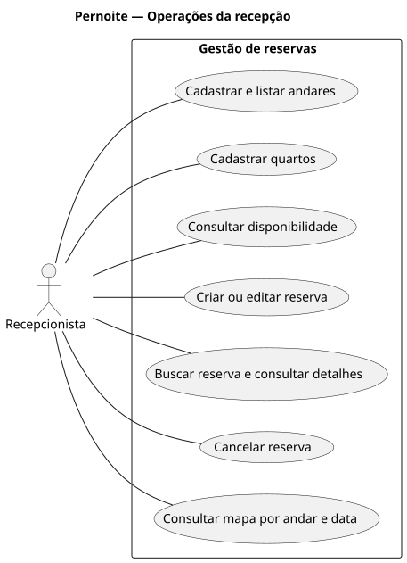
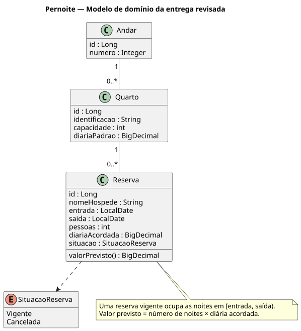
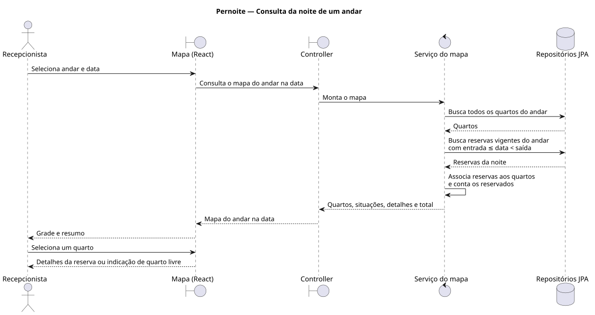

# UML da entrega revisada

Estes diagramas descrevem o modelo previsto para o CRUD de reservas e o mapa temporal após a revisão de 24/11/2026. As classes Java da primeira etapa ainda incluem elementos do [modelo anterior](../legado/README.md). Os requisitos que orientam a implementação estão na [especificação vigente](../requisitos.md).

## Casos de uso

A recepção configura o andar e seus quartos, administra reservas e consulta o mapa. [Editar em PlantUML](casos-de-uso.puml).

## Classes de domínio

Um andar pode ter vários quartos e cada reserva corresponde a um quarto. A situação e a diária acordada pertencem à reserva. O mapa é calculado para uma data. [Editar em PlantUML](classes.puml).

## Sequência da consulta temporal

A mesma consulta fornece a grade e o total do andar. Selecionar um quarto abre os detalhes daquela noite. [Editar em PlantUML](mapa-temporal.puml).

